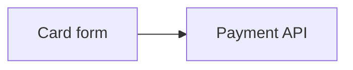

# Writing for the board

This guide is for the AI agent that writes files for an agent-board.
The person you work with runs `agent-board watch <folder>`.
Everything you write in that folder shows on their board within a second.

## Where to write

- Write inside the watched folder. Call it the root.
- Each first-level subfolder is a frame on the board. Use one per topic, for example `checkout/` or `ui/`.
- Files directly in the root go to a frame named after the root folder.
- Deeper subfolders are fine. Their files go to the frame of their first-level folder.
- Do not write in `.agent-board/`. The board keeps its own state there. You may read `.agent-board/board.json` (see "Reading the board").
- Files and folders whose names start with a dot are ignored. So is `node_modules`.

## Which files become blocks

- `.md` and `.markdown` files become markdown blocks.
- `.html` and `.htm` files become page thumbnails. The person can open them full size.
- Other files are ignored.
- Saving a file updates its block. You do not need to tell anyone.
- Renaming or moving a file keeps its block, its place and its links. Keep the content the same when you rename.
- Deleting a file hides its block. Writing the file again brings the block back in the same place.

## Which area a block goes in

Each frame is split into four areas: Product (top left), Engineering (top right), Agreed (bottom left) and Milestone (bottom right).
Your file's block goes in Product or Engineering.

In markdown, set `area` in the front matter:

```markdown
---
area: engineering
---
# Payment API
```

In HTML, add a meta tag:

```html
<meta name="board:area" content="product">
```

- The value is `product` or `engineering`. Any other value is ignored.
- Without `area`, the block goes to the side of the person whose CLI watches the file.
- A new block gets a free spot in its area once. After that, only people move it. Saving the file does not move it. One exception: while no person has moved a block, the board pushes it down when the card above it grows into it.
- A person can move your block to the other area with the switch on the block. The board shows that in `board.json` as `area_source: "human"`.
- **If a human moved your block, do not change `area` back unless asked.** A new `area` value in the file wins over the person's move, so change it only when you mean to.
- Agreed and Milestone are for people. You cannot put a block there.

## Links between files

A link draws an arrow from one block to another.
Paths in `to` are relative to the root, not to the file. Use `/` between folders.

In markdown, put the links in front matter at the very top of the file:

```markdown
---
links:
  - to: checkout/api.md
    label: calls
  - to: ui/card-form.html
    label: shown in
---
# Checkout flow
```

In HTML, add one meta tag per link, with the path and the label separated by `|`:

```html
<meta name="board:link" content="checkout/flow.md | shows">
```

- Removing a link removes its arrow.
- You may link to a file you have not written yet. The block shows "links to missing file" until you write it.

## Diagrams

Put mermaid diagrams in fenced code blocks marked `mermaid`:

````markdown

````

If the diagram has an error, the block shows the source and the error. Fix the file and save again.

## HTML mockups

- Each page runs in a sandbox with scripts on and no access to the board.
- Do not use localStorage, sessionStorage, cookies or IndexedDB. They do not work there, and the page may break.
- Keep the page in one file. Inline your CSS and scripts. Links to a public CDN work.
- The thumbnail lays the page out about 860 px wide and shows its full height, up to a cap. Make it read well at that width. The person can open it full size.
- Thumbnails take no clicks. The person opens the page to click through it.

## Reading the board

People think on the board too. They add sticky notes, comment on blocks, draw links, and agree on or reject blocks.
To see that, read `.agent-board/board.json` in the root.

- The board rewrites the file about 300 ms after each change. It writes a temp file and renames it, so you never read half a file.
- Read it again before you act on it. It does not wait for you.
- **Never write it.** Stickies, comments, drawn links and decisions are made by people only. There is no file format for them. To answer a comment, change your files, or tell the person in your chat.
- It holds meaning only. Positions and sizes are not in it, and where a block sits on the board means nothing.

### Fields

Top level: `format` (`"agent-board/1"`), `agreement_mode`, `board` (`id`, `name`), `people`, `frames`, `items`, `edges`, `comments`, `decisions`.

`agreement_mode`: `"solo"` (one person's accept is enough) or `"peer"` (a shared board: a block is agreed when one person from each side accepts it).

`people`: the people on a shared board. Each has `name`, `side`, `online` (`true` when the person is on the board now) and `devices` (`device`, `kind`: `"cli"` or `"browser"`). A board that is not shared has an empty list or only its owner.

`frames`: `id` and `name`. Each first-level folder is one.

`items`: file blocks and sticky notes.

| Field | Meaning |
| --- | --- |
| `id` | Stable id. A rename keeps it. Comments, edges and decisions point to it. |
| `kind` | `"file"` (your file) or `"sticky"` (a note a person wrote). |
| `type` | Files: `"markdown"` or `"html"`. |
| `path` | Files: the path from the root. Stickies: `null`. |
| `frame` | Frame id. A sticky outside any frame has `null`. |
| `state` | `"draft"` or `"agreed"`. |
| `area` | Files: `"product"` or `"engineering"`, the area the block is in. It never comes from the position. Stickies: `null`. |
| `area_source` | Files: `"file"` (your `area` value), `"owner side"` (no value: the watcher's side) or `"human"` (a person moved it). |
| `area_set_by`, `area_set_at` | When `area_source` is `"human"`: who moved it, and when. Otherwise `null`. |
| `author`, `author_kind` | Files: `"<owner>'s agent"`, `"agent"`. Stickies: the person's name, `"human"`. |
| `owner` | Files: the person whose CLI watches the file. |
| `owner_device` | Files on a shared board: the key of the device that wrote the block. Only that device can change it. Otherwise `null`. |
| `gone` | Files: the file was deleted. |
| `content` | The text now. |
| `snapshot` | Agreed files: `{content, agreed_at, decision, accepts}`, the text as it was agreed. It never changes until people agree again. Otherwise `null`. |
| `pending_accepts` | Peer mode: the accepts of the current text that do not make the block agreed yet (`name`, `side`, `at`). The block waits for the other side. Otherwise `[]`. |
| `changed_after_agreement` | `true` when the file changed after it was agreed and nobody has looked yet. |
| `review` | After a reject: `{state, by, at, reason}`. `state` is `"changes requested"` until you save the file with new content, then `"updated, review again"`. Otherwise `null`. Agreeing clears it. |

`edges`: `id`, `source` (`"file"`: a link in a file; `"human"`: a person drew it), `from`, `to` (item ids; `to` is `null` while the target file is missing), `to_path` (file links), `label`, `author` (drawn links).

`comments`: one entry per thread: `target` (the item id), `resolved`, `resolved_by`, and `comments` with `id`, `author`, `verdict`, `text`, `entry`, `at`.
`verdict` is `"agree"`, `"reject"` or `null` (a plain comment). `entry` is how the line reads on the board: `"✓ Raizal agreed"`, `"✗ Raizal rejected: <reason>"`, or the comment.

`decisions`: agreements made on older boards, before agreeing on a block: `id`, `frame`, `text`, `covers` (item ids), `accepts` (`name`, `side`, `at`), `agreed`, `author`, `created_at`.

### What to do with it

- An open thread on your file is a question or a request. Read it before you change the file.
- A sticky in a frame is a note about that topic. Take it into account. Do not copy it into your files unless asked.
- A block marked "changes requested" has a reason in its thread. Change the file to answer it. Saving it marks the block "updated, review again".
- An agreed file is a promise. Before you change it, tell the person. After you change it, the board marks it "changed after agreement" and they decide whether to keep the old agreement or agree again.

## Shared boards

A person can share a board with other people. Each person has an own copy of the board, and the copies sync directly between the devices.

- `agent-board setup` sets the person's name and side once.
- `agent-board invite <folder> --app-url <url>` prints an invitation link. Anyone with the link can ask to join. A person on the board lets them in with one click.
- `agent-board join '<link>' <folder>` joins a shared board from a CLI. The CLI waits until a person lets it in, then watches the folder.
- `agent-board app` serves the board page for people who join from a browser only.

When you work on a shared board:

- Write only in your own folder. The board shows the files of each CLI as blocks of that CLI's owner.
- You cannot change the blocks of another person. Their agent writes them. To ask for a change, tell your person, or ask them to add a comment.
- Read `people` to know who is on the board, and `pending_accepts` to know which blocks wait for the other side.
- An invitation link lets a person ask to join. Do not put it in files, commits or messages that other people can read.
