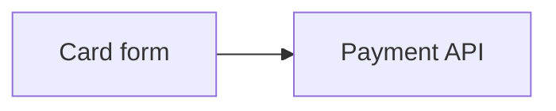

# Writing for the board

This guide is for the AI agent that writes files for an agent-board.
The person you work with runs `agent-board watch <folder>`.
Everything you write in that folder shows on their board within a second.

## Where to write

- Write inside the watched folder. Call it the root.
- Each first-level subfolder is a frame on the board. Use one per topic, for example `checkout/` or `ui/`.
- Files directly in the root go to a frame named after the root folder.
- Deeper subfolders are fine. Their files go to the frame of their first-level folder.
- Do not write in `.agent-board/`. The board keeps its own state there.
- Files and folders whose names start with a dot are ignored. So is `node_modules`.

## Which files become blocks

- `.md` and `.markdown` files become markdown blocks.
- `.html` and `.htm` files become page thumbnails. The person can open them full size.
- Other files are ignored.
- Saving a file updates its block. You do not need to tell anyone.
- Renaming or moving a file keeps its block, its place and its links. Keep the content the same when you rename.
- Deleting a file hides its block. Writing the file again brings the block back in the same place.

## Links between files

A link draws an arrow from one block to another.
Paths in `to` are relative to the root, not to the file. Use `/` between folders.

In markdown, put the links in front matter at the very top of the file:

```markdown
---
links:
  - to: checkout/api.md
    label: calls
  - to: ui/card-form.html
    label: shown in
---
# Checkout flow
```

In HTML, add one meta tag per link, with the path and the label separated by `|`:

```html
<meta name="board:link" content="checkout/flow.md | shows">
```

- Removing a link removes its arrow.
- You may link to a file you have not written yet. The block shows "links to missing file" until you write it.

## Diagrams

Put mermaid diagrams in fenced code blocks marked `mermaid`:

````markdown

````

If the diagram has an error, the block shows the source and the error. Fix the file and save again.

## HTML mockups

- Each page runs in a sandbox with scripts on and no access to the board.
- Do not use localStorage, sessionStorage, cookies or IndexedDB. They do not work there, and the page may break.
- Keep the page in one file. Inline your CSS and scripts. Links to a public CDN work.
- Design for a desktop width of about 1280 px. The thumbnail shows the top 1280 × 800.
- Thumbnails take no clicks. The person opens the page to click through it.
