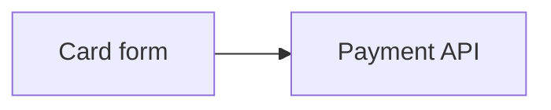

# Writing for the board

This guide is for the AI agent that writes files for an agent-board.
The person you work with runs `agent-board watch <folder>`.
Everything you write in that folder shows on their board within a second.

## Where to write

- Write inside the watched folder. Call it the root.
- Each first-level subfolder is a frame on the board. Use one per topic, for example `checkout/` or `ui/`.
- Files directly in the root go to a frame named after the root folder.
- Deeper subfolders are fine. Their files go to the frame of their first-level folder.
- Do not write in `.agent-board/`. The board keeps its own state there. You may read `.agent-board/board.json` (see "Reading the board").
- Files and folders whose names start with a dot are ignored. So is `node_modules`.

## Which files become blocks

- `.md` and `.markdown` files become markdown blocks.
- `.html` and `.htm` files become page thumbnails. The person can open them full size.
- Other files are ignored.
- Saving a file updates its block. You do not need to tell anyone.
- Renaming or moving a file keeps its block, its place and its links. Keep the content the same when you rename.
- Deleting a file hides its block. Writing the file again brings the block back in the same place.

## Links between files

A link draws an arrow from one block to another.
Paths in `to` are relative to the root, not to the file. Use `/` between folders.

In markdown, put the links in front matter at the very top of the file:

```markdown
---
links:
  - to: checkout/api.md
    label: calls
  - to: ui/card-form.html
    label: shown in
---
# Checkout flow
```

In HTML, add one meta tag per link, with the path and the label separated by `|`:

```html
<meta name="board:link" content="checkout/flow.md | shows">
```

- Removing a link removes its arrow.
- You may link to a file you have not written yet. The block shows "links to missing file" until you write it.

## Diagrams

Put mermaid diagrams in fenced code blocks marked `mermaid`:

````markdown

````

If the diagram has an error, the block shows the source and the error. Fix the file and save again.

## HTML mockups

- Each page runs in a sandbox with scripts on and no access to the board.
- Do not use localStorage, sessionStorage, cookies or IndexedDB. They do not work there, and the page may break.
- Keep the page in one file. Inline your CSS and scripts. Links to a public CDN work.
- Design for a desktop width of about 1280 px. The thumbnail shows the top 1280 × 800.
- Thumbnails take no clicks. The person opens the page to click through it.

## Reading the board

People think on the board too. They add sticky notes, comment on blocks, draw links and agree on what is done.
To see that, read `.agent-board/board.json` in the root.

- The board rewrites the file about 300 ms after each change. It writes a temp file and renames it, so you never read half a file.
- Read it again before you act on it. It does not wait for you.
- **Never write it.** Stickies, comments, drawn links and decisions are made by people only. There is no file format for them. To answer a comment, change your files, or tell the person in your chat.
- It holds meaning only. Positions and sizes are not in it, and where a block sits on the board means nothing.

### Fields

Top level: `format` (`"agent-board/1"`), `agreement_mode` (`"solo"`: one person's accept is enough), `board` (`id`, `name`), `frames`, `items`, `edges`, `comments`, `decisions`.

`frames`: `id` and `name`. Each first-level folder is one.

`items`: file blocks and sticky notes.

| Field | Meaning |
| --- | --- |
| `id` | Stable id. A rename keeps it. Comments, edges and decisions point to it. |
| `kind` | `"file"` (your file) or `"sticky"` (a note a person wrote). |
| `type` | Files: `"markdown"` or `"html"`. |
| `path` | Files: the path from the root. Stickies: `null`. |
| `frame` | Frame id. A sticky outside any frame has `null`. |
| `state` | `"draft"` or `"agreed"`. |
| `zone` | `"product"`, `"engineering"` or `"agreed"`. It comes from the state and the author's side, never from the position. |
| `author`, `author_kind` | Files: `"<owner>'s agent"`, `"agent"`. Stickies: the person's name, `"human"`. |
| `owner` | Files: the person whose CLI watches the file. |
| `gone` | Files: the file was deleted. |
| `content` | The text now. |
| `snapshot` | Agreed files: `{content, agreed_at, decision, accepts}`, the text as it was agreed. It never changes until people agree again. Otherwise `null`. |
| `changed_after_agreement` | `true` when the file changed after it was agreed and nobody has looked yet. |

`edges`: `id`, `source` (`"file"`: a link in a file; `"human"`: a person drew it), `from`, `to` (item ids; `to` is `null` while the target file is missing), `to_path` (file links), `label`, `author` (drawn links).

`comments`: one entry per thread: `target` (the item id), `resolved`, `resolved_by`, and `comments` with `id`, `author`, `text`, `at`.

`decisions`: `id`, `frame`, `text` (what was agreed), `covers` (item ids), `accepts` (`name`, `side`, `at`), `agreed`, `author`, `created_at`.

### What to do with it

- An open thread on your file is a question or a request. Read it before you change the file.
- A sticky in a frame is a note about that topic. Take it into account. Do not copy it into your files unless asked.
- An agreed file is a promise. Before you change it, tell the person. After you change it, the board marks it "changed after agreement" and they decide whether to keep the old agreement or agree again.
